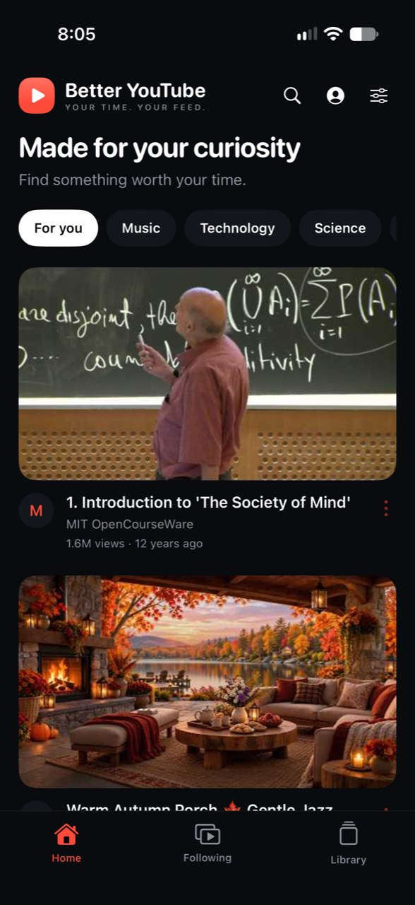
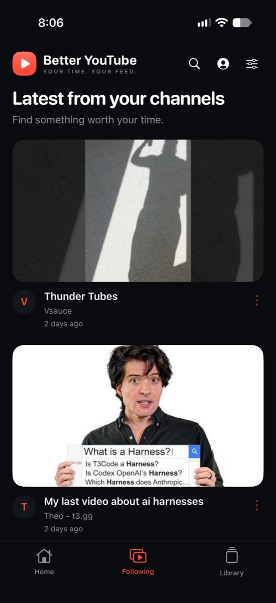
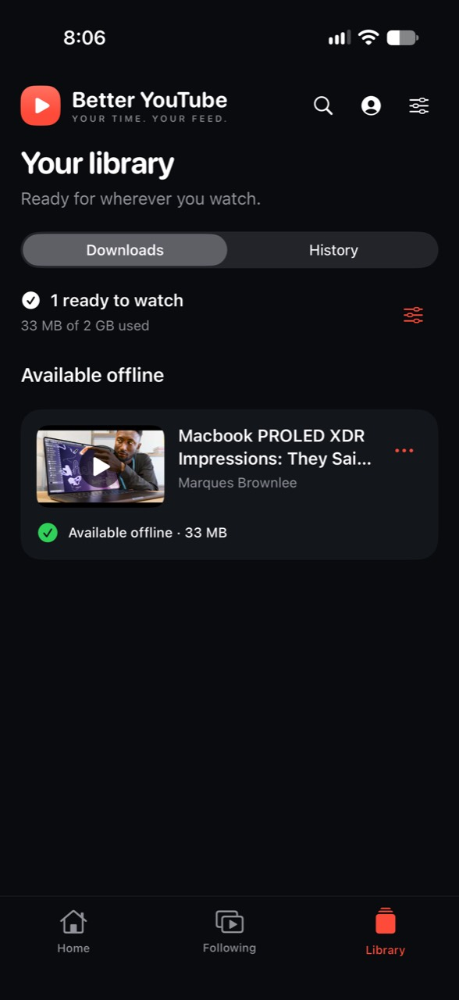

# Better YouTube

**Your time. Your feed.** An iPhone app with a native interface for discovering, watching, and saving YouTube videos, plus an optional self-hosted companion for offline downloads.

<table>
  <tr>
    <td></td>
    <td></td>
    <td></td>
  </tr>
</table>

## Repository layout

```text
ios/                       iPhone app, Xcode project, and UI tests
  BetterYouTube/           SwiftUI, WebKit, AVKit, and app assets
  BetterYouTubeUITests/    Simulator integration tests
  Config/                  Shared defaults and ignored local configuration
server/                    Companion API, download worker, and Docker deployment
scripts/                   Local setup, builds, and validation
```

## Features

- Discovery, search, subscriptions, an offline download library, and local watch history.
- Google sign-in through the system authentication browser. Sign-in is remembered securely on the device; no account email is hardcoded.
- Open YouTube video links at their linked timestamps, including Shorts, live, and embed links; browse linked playlists, channels, searches, and Clips in the app. See [YouTube links](docs/youtube-links.md).
- One-tap playback, fullscreen, Picture in Picture, AirPlay, captions/language selection, and playback speeds from 0.25× to 2×.
- Native playback for compatible streams and downloaded files, with web playback as fallback.
- Best-effort ad filtering. YouTube changes can affect playback, filtering, and extraction.
- Optional downloads and automatic saves for selected channels through your companion server.

## Get started

Requires macOS with Xcode and an iOS 17+ device or simulator. Setup scripts use Python 3.9+; the companion uses Python 3.12+; JavaScript checks use Node.js 18+.

```sh
python3 scripts/setup-ios.py
open ios/BetterYouTube.xcodeproj
```

Choose the **BetterYouTube** scheme and an iPhone simulator. The default configuration can build without Google or a companion; discovery and streaming are available, and sign-in/downloads explain the setup they need.

For an iPhone build, configure your own unique bundle identifier and Apple development team:

```sh
python3 scripts/setup-ios.py --bundle-id com.example.betteryoutube --team YOURTEAMID
bash scripts/install-iphone.sh YOUR_DEVICE_ID
```

Replace the examples with your own identifiers. Find the device ID with `xcrun devicectl list devices`. Enable Developer Mode and pair the device with Xcode. The install script also accepts `IPHONE_ID`; no particular device is built into the repository. You can also build and run directly from Xcode. This is a development-install workflow; it does not submit an App Store release.

## Connect Google

Create a Google Cloud project, enable **YouTube Data API v3**, configure the consent screen, and register an **iOS OAuth client** matching your app's bundle identifier. Add your account as a test user if the consent screen is in testing mode.

```sh
python3 scripts/configure-google.py --client-id YOUR_IOS_CLIENT_ID
```

Rebuild the app, open its account screen, and select **Sign in with Google**. This requests the YouTube `youtube.force-ssl` scope to read and manage subscriptions. Existing read-only connections are prompted to reconnect when subscribing or unsubscribing; the requested change finishes after Google access is granted. You can also use **Allow subscription changes** on the account screen. The callback is derived from your client ID; the setup script configures it without editing shared project files. There is no client secret in the app.

Google sign-in imports subscriptions. Use a video’s options menu to subscribe or unsubscribe, or unsubscribe from the channel list on the account screen. These changes sync to your YouTube account; automatic download rules remain independently controlled. It does not sign the embedded website into YouTube or provide a personalized Home recommendation API. Google projects in testing mode can require periodic reauthorization.

Following loads the latest 15 uploads per subscribed channel through the [YouTube Data API](https://developers.google.com/youtube/v3/docs/playlistItems/list) and combines them by publication date. It checks every subscription, with at most four upload requests in flight. Existing Google connections can use this without granting additional permissions. Failed refreshes preserve already-loaded videos and show a retry message; quota failures are identified explicitly. Signed-out discovery and the companion’s automatic downloads still use public channel RSS feeds.

## Optional companion server

See [server/README.md](server/README.md) for pairing and Docker deployment. The companion prepares files and checks selected channels every 30 minutes. It uses one download worker, no transcoding, half a CPU core, 512 MB RAM, and a bounded cache.

The server can prepare new videos while the app is closed. iOS decides when to wake the phone to fetch them, so overnight availability is not guaranteed. Force-quitting can delay background transfers until the app is opened again. Downloaded files play offline; captions require a subtitle track in the local file.

## Local configuration and privacy

Shared defaults live in `ios/Config/Defaults.xcconfig`. These files are local and ignored by Git:

- `ios/Config/Local.xcconfig`: bundle identifier and signing team.
- `ios/Config/Google.local.xcconfig`: Google callback scheme.
- `ios/BetterYouTube/Connection.plist`: Google client ID and optional server pairing.
- `server/.env`, `server/tls/`, and `server/state/`: server credentials, TLS keys, and runtime data.
- `.build*/` and `artifacts/`: compiled apps, diagnostics, and development records.

Setup preserves existing configuration unless you explicitly provide replacement values. Google tokens stay in the iOS Keychain; history and bookmarks stay on the device. The companion receives channel/video IDs, not the Google login. Review staged files before publishing; do not force-add ignored configuration, media, or logs.

## Validation

```sh
bash scripts/test-links.sh
node scripts/test-bridge.cjs
python3 -m unittest discover -s scripts -p 'test_*.py' -v
python3.12 -m venv .venv
.venv/bin/pip install -r server/requirements.txt
.venv/bin/python -m unittest discover -s server -p test_app.py -v
bash scripts/test-simulator.sh YOUR_SIMULATOR_ID
```

Use `xcrun simctl list devices available` to find a simulator, or set `SIMULATOR_ID`. UI integration tests use live YouTube content and may depend on network availability. Google integration requires your configured OAuth client. The end-to-end download test requires a running, paired companion. Native-file playback tests require the local MP4 fixture described in [ios/README.md](ios/README.md).

On macOS, the Python script tests also compile the production Swift feed loader and exercise uploads, channel batching beyond 40 subscriptions, publication dates, unavailable videos, and API failures with controlled HTTP responses.
